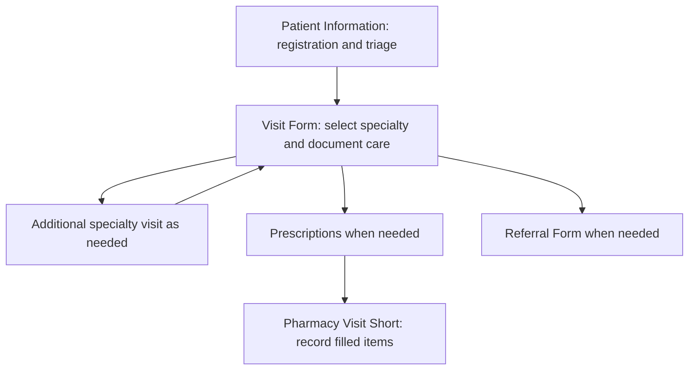

# GenAI EMR System

**A customizable REDCap pilot for documenting multidisciplinary medical outreach.**

This system brings registration, triage, specialty visits, prescriptions, referrals, and pharmacy dispensing into a shared patient record. Teams can adapt its forms and choices to their own outreach sites, providers, available medications, and services. It provides a starting structure; adopting it means making those program-specific choices and checking the connections between forms.

The project notes describe this version as a **pilot with AI improvements**, state that it is **not fully ready for deployment**, and identify **medication inventory as not implemented**. The folder name and project notes do not explain how AI was used. These exports do not document a model connection or automated AI-generated clinical output; the workflow described here is the REDCap configuration visible in the supplied files.

[Back to the project overview](../README.md) · [Browse the form preview](Digital-IMOP-REDCap-AI-System%20_%20REDCap.pdf)

## How a patient moves through the system

The forms support the following path. Each program decides which staff own each stage and how patients move between services.

1. **Register and triage the patient.** Patient Information collects names, date of birth, contact details, site, allergies, current medications, and specialty assignments. Age is calculated from date of birth and the current date; guardian information appears for patients younger than 18. Depending on the assigned services, staff can document vital signs, categorized complaints, or a dental reason for visiting.
2. **Document the specialty encounter.** Visit Form displays shared registration and triage details so the next team can see information already entered. Staff select the specialty, and conditional fields display the relevant history, assessment, treatment, and follow-up sections. The XML explicitly configures this form as repeating, allowing multiple visit entries within one patient record.
3. **Arrange another service when needed.** An internal-referral question reveals a link back to Patient Information, where staff can add another specialty assignment. A separate Referral Form provides a formatted referral template with some patient details filled from the record.
4. **Record prescriptions when needed.** Staff choose medications from grouped lists. Each selected item reveals fields for the amount, usage instructions, and prescribing provider.
5. **Document dispensing.** Pharmacy Visit Short displays selected prescription items with their recorded amounts, instructions, and providers. Staff mark individual items as filled and record whether all medications have been dispensed to the patient.

Only Visit Form is configured to repeat in this export. Prescriptions and pharmacy dispensing are recorded in separate forms at the patient-record level, so a program needing distinct prescription sets for every encounter should decide how to adapt that structure.

## What the forms cover

| Form | What adopters can expect |
| --- | --- |
| **Patient Information** | Shared registration and triage, a site list, specialty assignments, allergies and medications, conditional vital signs, categorized chief complaints, and dental intake. |
| **Visit Form** | Specialty-dependent clinical documentation, shared patient summaries, assessment and treatment notes, internal referral, and follow-up. |
| **Prescriptions** | A predefined medication list organized by category, with conditional amount, instruction, and provider fields for each selected item. |
| **Referral Form** | A formatted descriptive template containing referral headings and selected patient details. It is currently one descriptive field, rather than a set of separate referral-entry and status fields. |
| **Pharmacy Visit Short** | A prescription summary and filled-item controls, plus an overall “all medications dispensed” question. This documents dispensing; the project notes say medication inventory is not implemented. |

The visit specialty menu currently includes **Pediatrics, Occupational Therapy, Physical Therapy, Dental, General Medicine, Nutrition, and Ophthalmology**. Registration uses a shorter assignment list: General Medicine, Physical Therapy, Occupational Therapy, Ophthalmology / Optometry, and Dentistry. These two menus should be aligned with how the adopting program routes patients.

Within Visit Form, the available sections include:

- **General medicine and pediatrics:** history, positive and negative review-of-systems findings with explanatory prompts, categorized diagnoses, additional medical values, urine-test documentation, treatment notes, and follow-up.
- **Occupational and physical therapy:** home setup, functional activities, range of motion, sensory testing, pain before and after treatment, goals, interventions, and therapist details. Occupational therapy includes separate child and adult paths, with the current division at age 14 and developmental milestone sections for younger children.
- **Eye care:** visual acuity for each eye, structured findings, awareness of conditions, family history, and referral needs.
- **Dental care:** extraction and filling details, tooth surfaces, procedures, anesthetic documentation, and dentist signature.
- **Nutrition:** presenting concerns, history, diagnosis, intervention choices, and treatment notes.

These are configurable documentation choices from the export. The listed diagnoses, treatments, age cutoffs, and medications are examples of this project's configuration, rather than universal clinical recommendations.

## What to personalize

Most adaptation centers on editing form content, choice lists, and the rules that show relevant fields. Several choices appear in multiple places, so linked edits matter.

| Program decision | Current configuration | What to adapt together |
| --- | --- | --- |
| **Outreach locations** | The site menu contains `Site 1`, `Site 2`, and `Site 3`. | Replace these placeholders with your locations and check any summaries or reports that use site information. |
| **Provider roster** | Medication-specific provider menus contain `Provider 1` through `Provider 14`. | Replace the roster consistently across all medication provider fields. Review the separate therapist name, credentials, and signature fields for your documentation needs. |
| **Available medications** | A fixed formulary is grouped into categories such as antimicrobials, analgesics, respiratory/allergy, cardiovascular, gastrointestinal, topicals, and vitamins. | Match local names, strengths, and formulations. Keep medication choices, amount/instruction/provider fields, pharmacy display rows, and filled controls consistent. |
| **Services and patient routing** | Registration assignments and visit specialties use different menus and numeric codes. | Agree on the services offered, then update both menus, the specialty-dependent fields, and the internal-referral path. |
| **Measurements and age rules** | Intake uses inches, pounds, Fahrenheit, and glucose in mg/dL. Age uses today's date; guardian and therapy paths use age-based rules. | If changing units or age handling, update labels, validations, calculations such as BMI, and every summary that displays the values. Review the age cutoffs against your program's workflow. |
| **Clinical documentation** | Complaint, diagnosis, intervention, and test choices reflect the supplied pilot. | Have your providers choose the needed lists and prompts, including local terminology, language, services, and available tests. Preserve the conditional fields tied to each choice. |
| **Referral and reporting needs** | The referral is a descriptive template with a fixed date label; the XML also contains saved case-specific reports. | Adapt referral headings, date text, and populated values for your receiving services. Review saved report filters and fields for the information your program wants to review. |

### A practical preparation checklist

- [ ] Confirm who will register patients, document visits, prescribe, and record dispensing.
- [ ] Replace site and provider placeholders, and tailor the specialty and medication lists.
- [ ] Review required contact fields for what your outreach team can collect; the current form requires phone, email, and home address.
- [ ] Check shared summaries after editing field names or choices. Some current referral and pharmacy summaries reference fields absent from this data dictionary, such as `chief_complaint`, `weight_kgs`, and `diagnosis_gm`; connect them to the fields your adapted project actually uses.
- [ ] Relink or upload the pain-map and tooth-number illustrations for your REDCap environment; the current image references point to the originating REDCap host.
- [ ] Walk through example patients across relevant specialties and age groups, including multiple visit entries, internal referrals, medication selection, and dispensing.
- [ ] Confirm that each medication choice has matching prescription details and pharmacy controls, and decide how your team will manage stock while inventory remains outside this pilot.

## Files in this folder

| File | How to use it |
| --- | --- |
| [PDF form preview](Digital-IMOP-REDCap-AI-System%20_%20REDCap.pdf) | Browse the supplied form presentation before discussing changes with the team. |
| [CSV data dictionary](DigitalIMOPREDCapAISystem_DataDictionary_2026-10-11.csv) | Inspect the field names, labels, choices, calculations, required fields, and conditional-display rules. This is the most direct reference for planning form changes. |
| [REDCap XML project export](DigitalIMOPREDCapAIS_2026-10-11_1537.REDCap.xml) | Inspect the project metadata, form definitions, repeating-visit configuration, and saved reports when preparing an adapted REDCap project. |

This description is based on the supplied CSV and XML configuration. Actual behavior after adaptation should be checked in the adopting team's REDCap environment.
