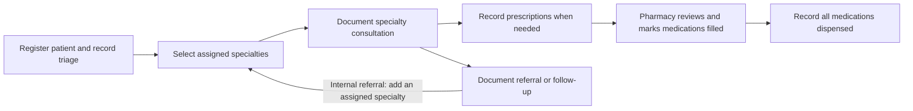

# Original EMR system

**A REDCap template for documenting care across an international medical outreach clinic: registration and triage, specialty consultations, prescriptions, pharmacy dispensing, and referrals.**

The project notes describe a digital system built from physicians' feedback. Its eight forms share patient information, so a provider can review triage details during a consultation and pharmacy staff can see the selected medications, quantities, instructions, and prescriber. Specialty and medication selections show the relevant follow-up fields.

The workflow provides a reusable starting point. A team adapts the sites, participating providers, services, medication supply, and documentation choices to its own outreach program. Most personalization centers on form choices, labels, and display rules; changes to a shared choice also need to stay consistent wherever that choice is used.

[Back to the repository overview](../README.md)

## How a patient moves through the system

This diagram summarizes the handoffs represented in the forms. Each program decides which staff complete each stage and how to close encounters that do not require medication.

| Stage | What staff record or review |
| --- | --- |
| **Registration and triage** | Create the patient record; enter name, date of birth, contact details, site, allergies, and current medications. Age is calculated from date of birth. Select one or more assigned specialties. Record vital signs and relevant presenting concerns; some triage fields appear only for general medicine or dentistry. |
| **Specialty consultation** | Review the patient and triage summary, then choose the consultation specialty. The Visit Form offers pediatrics, occupational therapy, physical therapy, dental, general medicine, nutrition, and ophthalmology. The selection controls which assessment, findings, treatment, and other documentation fields appear. |
| **Another consultation** | The XML configures the Visit Form as a repeating instrument, allowing more than one consultation entry for a patient. For an internal referral, the form directs staff back to Patient Information to add another assigned specialty. |
| **Prescribing** | Select medications from the configured categories. Each selection reveals fields for quantity, usage instructions, and provider. The available medication names, strengths, and provider choices reflect this template's configuration. |
| **Pharmacy** | Review the patient summary and selected prescriptions in Pharmacy Visit Short. Record each medication's `FILLED` status, then use `ALL MEDS DISPENSED TO PATIENT` to record the overall dispensing status. |
| **Referral and follow-up** | Record recommendations, follow-up, and referral information in the applicable specialty sections. The separate Referral Form is a formatted layout that displays some existing patient details; much of its content consists of static headings, so adapt it if staff need additional information captured as editable fields. |

The XML also includes specialty queues, pharmacy reports, and dashboards. Their filters need to match the team's handoff rules before staff use them to manage the clinic.

## What is included

The eight instruments are **Patient Information**, **Visit Form**, **Prescriptions**, **Referral Form**, **Pharm Hidden**, **_Inventory Control**, **Provider Information**, and **Pharmacy Visit Short**.

The first four and Pharmacy Visit Short support the workflow of documenting patient care. Provider Information contains three sets of name, NPI, and contact fields. Pharm Hidden contains supporting medication calculations. _Inventory Control contains starting quantities and calculated remaining quantities, including spare medication slots labeled with placeholders.

Inventory calculations subtract recorded prescription quantities across records from a configured starting quantity. They do not, by themselves, confirm physical stock or distinguish all prescribed quantities from quantities actually dispensed. A program should decide which quantity it wants to track, supply its own starting amounts, and review the calculations and availability messages accordingly.

## Personalize it for your program

The template separates much of the program-specific content into selectable lists and fields. For example, a new provider roster changes the prescriber choices; a different medication supply changes the formulary and its matching pharmacy and inventory entries. The same workflow can then reflect the team and supplies actually available.

| Customize | Current example | What to align |
| --- | --- | --- |
| **Outreach sites** | `Site 1`, `Site 2`, and `Site 3`. | Replace the site labels with the locations used by your program; adjust location-specific summaries or filters if needed. |
| **Provider roster** | Medication prescriber dropdowns list `Provider 1` through `Provider 14`; Provider Information has three provider slots. | Enter the participating providers and relevant credentials/contact information. Update prescriber choices across the medication fields and align the information form with the roster size. |
| **Medication supply** | Predefined medication categories, names, strengths, quantities, and some quantity notes. | Use your actual formulary and units. Keep medication selections, pharmacy summaries, filled-status fields, inventory formulas, starting quantities, and availability thresholds consistent. Have the program's clinical team review the medication labels and quantity notes. |
| **Services and clinical documentation** | Five triage assignment choices and seven consultation specialties, with specialty-dependent fields. | Match the services your team offers, including complaint/diagnosis choices, examination sections, treatment fields, dental notation, and referral destinations. Review the display rules when changing specialty choices. |
| **Patient intake and local conventions** | Required contact fields; English labels; Fahrenheit, inches, pounds, and an imperial BMI calculation. | Decide which information staff can collect, revise required fields and wording, and adapt language, measurement units, validations, and related calculations together. |
| **Clinic handoffs and reporting** | Specialty queues, prescription-completion filters, medication-filled flags, and an overall dispensing flag. | Define when a patient is waiting, has completed a consultation, or has finished pharmacy. Make reports reflect those definitions, including patients who receive no medication. |
| **Referral layouts and summaries** | A referral layout with a fixed date label and dashboards containing existing tables. | Replace dates, organization details, and existing table content; add editable referral fields where your process needs them. |

Medication choices and quantity notes are examples from the exported project, rather than a prescribing protocol for adopting programs.

### Before first use

- [ ] Agree on the services, staff responsibilities, patient information, and local units the clinic will use.
- [ ] Replace site/provider placeholders and adapt the formulary, starting quantities, and referral content.
- [ ] Check the queue filters against the specialty choices. Two reports with dental titles currently use assignment code `2`, which represents Physical Therapy in this dictionary; one also filters on a fixed historical date. Several triage queues check for a blank dispensing flag, while that field is configured with a default of `0`.
- [ ] Replace historical content embedded in dashboards and review shared summaries for references to fields your adapted project actually contains.
- [ ] Relink or upload the pain-map and tooth-number illustrations for your REDCap environment; the current image references point to the originating REDCap host.
- [ ] Walk through representative patient records in your REDCap environment: a single consultation, multiple specialties, a referral, medication dispensing, and an encounter without medication. Confirm that the expected fields, summaries, and queues appear.

Only the Visit Form is listed as repeating in the exported XML. If your program needs separate prescriptions or pharmacy records for every encounter, review that arrangement during adaptation.

## Files in this folder

| File | Use it for |
| --- | --- |
| [REDCap project XML](DigitalIMOPREDCapOri_2026-10-11_1533.REDCap.xml) | The exported project configuration, including forms, repeating-visit settings, reports, and dashboards. |
| [CSV data dictionary](DigitalIMOPREDCapOriginalSyste_DataDictionary_2026-10-11.csv) | Field names, labels, choices, validation rules, calculations, required fields, and conditional display rules. This is the clearest reference for planning personalization. |
| [PDF reference](Digital-IMOP-REDCap-Original-System%20_%20REDCap.pdf) | An included visual reference to the REDCap field design. |

This description is based on the supplied CSV and XML configuration. Actual behavior after adaptation should be checked in the adopting team's REDCap environment.
