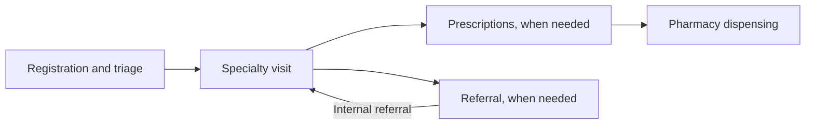

# Digitalization Medical Programs

**Customizable REDCap electronic medical record (EMR) templates for international medical outreach programs.**

These systems organize the information collected as a patient moves through an outreach clinic: registration and triage, specialty consultations, prescriptions, referrals, and pharmacy dispensing. They provide an existing workflow that a new program can adapt to its team, sites, services, and medication supply.

Each folder has its own guide. Start with the descriptions below, then open the relevant guide for the patient workflow, included forms, and specific places to personalize.

## Explore the two systems

| System | Description | Adoption focus |
| --- | --- | --- |
| [Original EMR system](Original-EMRSystem/README.md) | A design developed from physician feedback, with eight forms covering clinical documentation, pharmacy, medication inventory calculations, and provider information. | Adapt the provider roster, formulary, stock quantities, specialty forms, and clinic reports to your outreach program. |
| [GenAI EMR system](GenAI-EMRSystem/README.md) | A five-form pilot with reorganized intake and visit documentation, grouped complaint and diagnosis selections, and linked prescription and pharmacy forms. | Adapt the same clinic-specific content and review the pilot's form links and summaries. The project notes identify it as a pilot awaiting deployment preparation, with medication inventory not implemented. |

The GenAI project notes describe AI improvements. The included exports document the REDCap forms and configuration; they do not establish a live AI service or automated clinical decision-making workflow. The separate guide describes the features visible in those files.

## The shared patient workflow

Staff record the patient's identifying information, presenting concerns, and relevant measurements at intake. Providers then select the specialty for the consultation and complete the applicable assessment fields. Both projects configure the Visit Form to repeat, allowing additional consultations within the same patient record. Prescription details feed into the pharmacy view, where staff record whether each medication was filled. Visit fields document referrals and follow-up; the separate Referral Form provides a formatted template.

The diagram describes the intended clinic flow. Each adopting team defines who performs each step and how patients move between stations.

## Make the system your own

The templates make much of the customization a matter of editing form content and REDCap configuration. You can retain the overall structure while tailoring the details to your program.

| What to personalize | What this means in practice |
| --- | --- |
| Providers | Replace the provider placeholders in prescription dropdowns with your team's roster. In the Original system, also adapt the Provider Information form. |
| Medications | Match the medication list, strengths, formulations, quantity labels, and instructions to the supplies your program uses. Keep prescription fields and their pharmacy displays aligned. |
| Clinic sites and services | Replace the example site names and select the specialties your team offers. Update the rules that show fields for each specialty when those choices change. |
| Intake and documentation | Adapt language, required contact details, complaint and diagnosis lists, measurements, and specialty assessments to the patients and providers you serve. |
| Referrals and handoffs | Add local referral options and contact details; update the referral summary and the process for an additional consultation. |
| Inventory and clinic views | For the Original system, set starting stock and review its stock calculations and dashboards. In both versions, adapt the included reports and summary text to the current program. |

**Simple edits can have linked effects.** Changing a provider label is usually a straightforward roster update; adding a medication also means updating its prescription fields and pharmacy display. Changing measurement units also means reviewing the related calculations and summaries. Each system guide explains these dependencies with examples.

## What the folders contain

Both folders include three reference artifacts:

- **REDCap project XML:** the project structure and exported configuration, including settings beyond the field dictionary.
- **Data dictionary CSV:** a field-by-field reference for labels, choices, calculations, required fields, and rules that control when fields appear.
- **REDCap PDF:** an included visual reference for reviewing the forms.

Adoption takes place in a REDCap environment. Use the guides and exports to prepare a project for your program, assign staff access, and walk through representative patient scenarios before first use. Include a patient with multiple consultations and a prescription handed over to pharmacy so that linked forms are reviewed together.

These initial descriptions are based on the supplied project exports. Background on the development of the two systems and a fuller discussion of their use will be added as program context becomes available.
